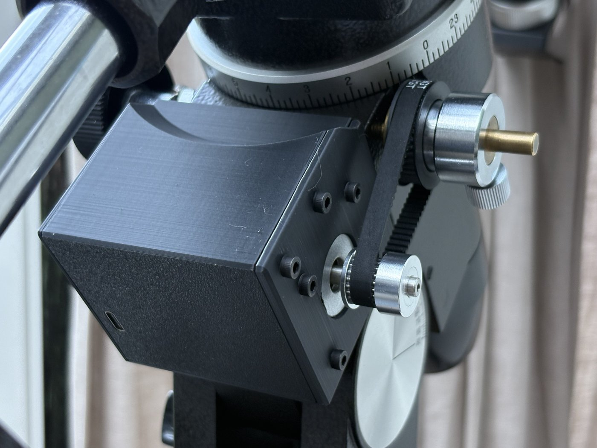
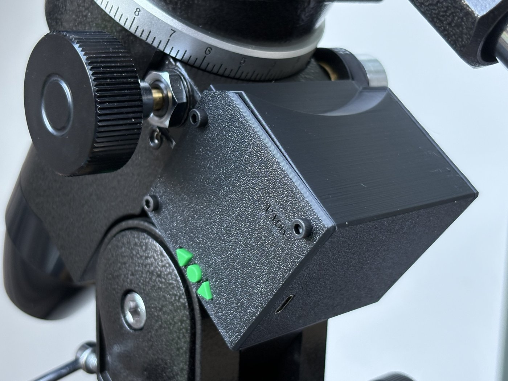

# Vixen SP RA drive

A compact, 3D-printed sidereal drive for the right-ascension axis of a **Vixen Super Polaris (SP)** equatorial mount.
It replaces the original MD-5 controller and MD-5sp motor with a NEMA 17 stepper, a GT2 belt onto the worm shaft,
a LilyGO T-Motor board (ESP32 + TMC2209) and three buttons you can find by feel in the dark.
Power comes from any USB-C PD power bank. Everything sits in one housing on the original dovetail clamp,
and the original MD-5sp motor stays untouched.

| Front: belt from the motor to the worm shaft | Back: the three buttons and the USB-C power input |
|---|---|
|  |  |

*Test print in black PLA Matte, with the push pins printed in green. The version label on the back plate in the photo
belongs to the previous revision; the final STL files carry no text.*

| | |
|---|---|
| Tracking | sidereal, silent (StealthChop, 1/256 microstepping) |
| Slewing | 5× and 100× in both directions |
| Resolution | 0.080″ on the sky per microstep |
| Power | USB-C PD power bank, 9 V via a PD trigger board |
| Controls | three buttons on the back; no hand controller, no cables besides the power bank |
| Clutch | the original Vixen slip clutch is kept: loosen the thumbscrew and the RA axis moves freely by hand |
| Updates | over WiFi (Arduino OTA), no need to open the housing |

**Status:** built, printed in black PLA and tested on the mount (November 2026): tracks with a telescope on,
5× and 100× without lost steps, the motor stays cold. A trial period on PLA is running; a final print in
PETG-CF is planned. Sidereal rate calibration against a star is still to be done.

## How it works

```
NEMA 17 ── 20T GT2 ── belt 158 mm ── 44T printed pulley ── original slip clutch ── worm ── worm wheel (144 T)
            2.2 : 1                                                               144 : 1      total 316.8 : 1
```

The printed 44T pulley takes the place of the brass gear inside the Vixen's own slip clutch, clamped by the
original thumbscrew. Belt tension is set by sliding the housing along the dovetail before tightening it.

Tracking rate: 51 200 microsteps × 2.2 / 598.36 s = **188.25 Hz** (598.36 s = one sidereal day / 144).

## Controls

Seen from the back of the housing:

| You do | It does |
|---|---|
| nothing | track at 1× |
| hold right / left arrow | 5× with the stars / against them |
| hold round + an arrow | 100× |
| release | back to 1× (0.5 s ramp) |
| hold both arrows for 3 s | reverse the tracking direction (stored, e.g. for the southern hemisphere) |
| hold round while powering on | WiFi + OTA update mode |

## Repository layout

| Folder | Contents |
|---|---|
| [`stl/`](stl) | ready-to-print parts, already in their print orientation |
| [`cad/`](cad) | parametric CadQuery source (`housing.py`, `pulley.py`), `export_stl.py`, STEP files |
| [`firmware/`](firmware) | Arduino sketch for the LilyGO T-Motor |
| [`docs/`](docs) | [bill of materials](docs/bom.md), [printing](docs/printing.md), [assembly](docs/assembly.md), [electronics & firmware](docs/electronics-firmware.md) |

GitHub shows STL files as an interactive 3D view: click any file in `stl/` to look around it.

## Building one

1. Get the parts in the [bill of materials](docs/bom.md).
2. [Print](docs/printing.md) the housing, push pins and pulley. Print the bore test strip first in your own filament.
3. Flash the [firmware](docs/electronics-firmware.md) over USB once; later updates go over WiFi.
4. [Assemble](docs/assembly.md) the housing and fit it to the mount.

## Will it fit my mount?

It was designed and measured on a **Vixen Super Polaris** with the MD-5sp motor bracket (dovetail clamp).
The Great Polaris (GP) uses the same style of worm and clutch and may well fit, but this has not been checked.
Measure your worm-shaft bush (13.0 mm here), the clutch recess (~31.5 mm) and the dovetail before printing.
All dimensions are named variables at the top of `cad/housing.py` and `cad/pulley.py`.

## Design notes

- **Why a belt and not a direct gear:** a NEMA 11 on the brass gear did not have enough torque at a current that
  PLA near the motor tolerates. A NEMA 17 with a 2.2 : 1 belt reduction has plenty of margin at 0.48 A.
- **Why 1/256 and StealthChop:** with 1/32 and MicroPlyer the driver sees standstill at 1× and lost steps;
  SpreadCycle was louder and not stronger.
- **Why the pulley bore is printed tight:** 0.5 mm of runout gives ± 3.6 % rate wobble with a 598 s period
  (± 50″). Re-tune the bore with the test strip for every new filament.
- **Every part prints without supports:** each part has an orientation in which everything grows upward;
  edges that touch the bed are chamfered instead of rounded.

## Possible upgrades

A machined aluminium 44T pulley or a 0.9° motor if microstep jitter or pulley runout ever shows up in autoguiding.
A cover over the belt.

## Licence

- Hardware (CAD, STL/STEP, documentation): [CERN-OHL-P-2.0](LICENSE-HARDWARE)
- Software (firmware, Python scripts): [MIT](LICENSE)
- `cad/third_party/lilygo/Shell.stl` is from [Xinyuan-LilyGO/T-Motor](https://github.com/Xinyuan-LilyGO/T-Motor), MIT licence;
  it is only used for its outline.

Not affiliated with Vixen or LilyGO. Build and use at your own risk.
