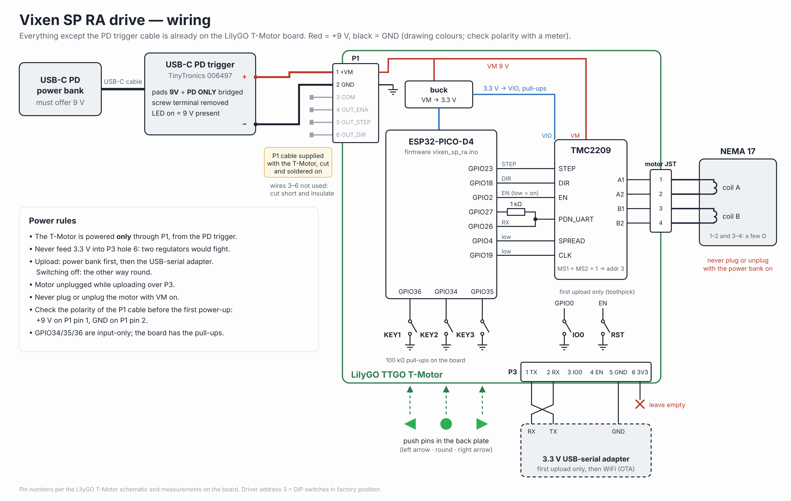

# Electronics and firmware

## Wiring



*Editable source: [`img/wiring.svg`](img/wiring.svg).*

```
USB-C power bank → PD trigger (fixed 9 V) → T-Motor P1 (pin 1 +VM, pin 2 GND)
                                               ├─ TMC2209 → motor JST → NEMA 17
                                               └─ on-board buck → 3.3 V → ESP32-PICO-D4
Buttons on the board: KEY1 (GPIO36), KEY2 (GPIO34), KEY3 (GPIO35), pull-ups on the board
```

**PD trigger to P1.** The T-Motor comes with a cable for its 6-pin P1 connector. Cut the plug off with a few
centimetres of wire, solder wire 1 to the PD trigger's **+** and wire 2 to **−** (on the pads where the screw terminal
was), and cut wires 3–6 short and insulate them. Bridge the **9V** and **PD ONLY** pads on the PD trigger so it always
asks for 9 V. Before plugging into the T-Motor: power bank on, meter on V DC, and check +9 V on P1 pin 1 against pin 2.

No other soldering on the T-Motor is needed. The three buttons are pressed through the back plate by the push pins.

| Signal | GPIO |
|---|---|
| STEP / DIR / EN | 23 / 18 / 2 (EN active low) |
| TMC2209 UART TX / RX | 27 (through 1 kΩ) / 26, driver address **3** (DIP switches in factory position) |
| SPREAD / CLK | 4 low / 19 low |
| KEY1 / KEY2 / KEY3 | 36 / 34 / 35 |

**Power rule:** the T-Motor is powered **only** through P1 from the PD trigger. Never also feed it 3.3 V from a
USB-serial adapter: the two regulators would fight.

## Driver settings (set by the firmware over UART)

1/256 microstepping with interpolation, StealthChop, IHOLD = IRUN, TPOWERDOWN 20. The driver is only enabled once
it reports version 0x21 and the write counter (IFCNT) proves all four configuration writes arrived. It is checked
every second and reconfigured after a reset.

Current: `CS 16` (≈ 0.48 A rms) for tracking and 5×, `CS 22` (≈ 0.65 A) above 10×, for at most 120 s at a time.
Formula with VSENSE = 1 and Rsense 0.12 Ω: I_rms = (CS + 1) / 32 × 0.18 V / 0.14 Ω / √2.
In practice the motor stays cold and has plenty of torque with a telescope on.

## First upload (USB-serial)

The T-Motor has no USB socket. The first upload goes through its **P3** header (holes, no pins) with any
**3.3 V USB-serial adapter**. An ESP32-C3 board running [`usb_serial_bridge.ino`](../firmware/usb_serial_bridge/usb_serial_bridge.ino)
works too.

| Adapter | T-Motor P3 |
|---|---|
| TX | hole 2 (RX) |
| RX | hole 1 (TX) |
| GND | hole 5 (GND) |
| 3.3 V | **not connected** (hole 6 stays empty) |

Header pins pushed slightly askew into the holes and taped make good enough contact for one upload.

1. Arduino IDE: install the core **"esp32 by Espressif Systems" 3.x**, board **ESP32 PICO-D4**, default partition
   scheme (it has OTA), upload speed 115200. Open `firmware/vixen_sp_ra/vixen_sp_ra.ino`.
2. Motor unplugged. **Power bank first**, then the USB cable of the adapter. (Off: the other way round.)
3. Download mode: hold **IO0**, tap **RST**, release IO0 (the carrier has small holes over both buttons for a toothpick).
4. Upload. If the IDE's automatic reset gets in the way (it does with the C3 bridge), use *Sketch → Export Compiled Binary*
   and flash the `.merged.bin` with esptool and `--before no-reset --after no-reset` at address 0x0.
5. Tap RST. The serial monitor (115200) shows the start-up lines and `Driver on, tracking started` once the motor
   supply is present.

## Updates over WiFi (OTA)

1. Power off. Hold **round**, power on, release after 2 s.
2. Join the WiFi network **`VixenSP-RA`** (password `vixensp-ra`).
3. Arduino IDE: board ESP32 PICO-D4, port **`vixen-sp-ra at 192.168.4.1`**, Upload, password `vixen`.
4. At 100 % the board restarts with the new firmware.

Change the network name and passwords at the top of the sketch if you like. WiFi is off unless you start it.

## Serial commands

`x` driver off · `a` driver on · `w` WiFi + OTA on · `d` reverse direction. A status line is printed every second.

## Settings you may want to change

| Constant | Default | |
|---|---|---|
| `PULLEY_MOTOR`, `PULLEY_WORM` | 20, 44 | belt reduction |
| `WORM_PERIOD_S` | 598.36 | calibrate against a star |
| `SPEED_SLOW`, `SPEED_FAST` | 5, 100 | × sidereal; the step generator tops out at 22.5 kHz (≈ 119× with 20:44) |
| `CS_TRACK`, `CS_FAST` | 16, 22 | motor current; keep it modest in a PLA housing |
| `DIR_HIGH_WHEN_TRACKING` | true | default direction before you reverse it with the buttons |
